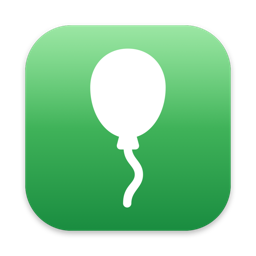

  

<h1 align="center">FocusWell</h1>

  
  
  

FocusWell gives the window under the mouse the keyboard focus without bringing it to
the front. Point at a window and type: the keys go there, and the window stays where it
is in the stack. A terminal half hidden behind an editor takes your commands while the
editor stays on top.

It runs on macOS 14 or later, on Apple silicon and Intel Macs.

## Install

    brew tap moetiker/FocusWell https://github.com/moetiker/FocusWell
    brew trust --cask moetiker/focuswell/focuswell
    brew install --cask focuswell

`brew trust` exists from Homebrew 6 on; skip it on older versions.

Or download the zip from the [latest release](https://github.com/moetiker/FocusWell/releases/latest)
and move FocusWell.app into the Applications folder.

On the first start macOS asks for Accessibility access. Click **Open System Settings**
and switch FocusWell on under Privacy & Security > Accessibility.

## Use

FocusWell lives in the menu bar as a balloon:

| | |
|---|---|
|  | The focus follows the mouse. |
|  | Off, or Accessibility access is missing. |

- `Click`: Switch FocusWell on or off. Without Accessibility access, the click asks for it.
- `Right-click, Control-click`: Open the menu with Quit.
- `Control` held: Pause while you move the mouse, for example to cross a window on the
  way to another one.

FocusWell leaves the focus alone while a mouse button is held, while a menu is open,
and in Mission Control and the Dock. A dialog that has the focus keeps it, and floating
windows such as palettes do not take it.

## Build

Building needs Xcode or the Command Line Tools with Swift 6.

    make app        # build/FocusWell.app
    make install    # into /Applications
    make test

The build signs with the first Developer ID Application certificate in the keychain,
and ad hoc without one. `SIGN_IDENTITY` names another identity, `-` forces ad hoc.

A release is signed and notarized:

    xcrun notarytool store-credentials FocusWell --apple-id <apple id> --team-id <team id>
    make clean
    make notarize cask

This leaves build/FocusWell-<version>.zip for the GitHub release `v<version>` and points
Casks/focuswell.rb at it.

## Troubleshooting

To see what FocusWell decides, start it from a terminal with logging:

    FOCUSWELL_VERBOSE=1 /Applications/FocusWell.app/Contents/MacOS/FocusWell

After a rebuild signed ad hoc, macOS no longer recognises the app. `make install` resets
its Accessibility entry, and macOS asks for access again on the next start. When FocusWell
is missing from the Accessibility list or stays red while switched on, add
/Applications/FocusWell.app with the plus button.

## Credits

FocusWell started as a fork of [AutoRaise](https://github.com/sbmpost/AutoRaise) by
sbmpost, reduced to focusing without raising. Focusing without raising uses the method
of [yabai](https://github.com/koekeishiya/yabai). Like AutoRaise, FocusWell is licensed
under the GNU General Public License, version 3 (LICENSE.md).
